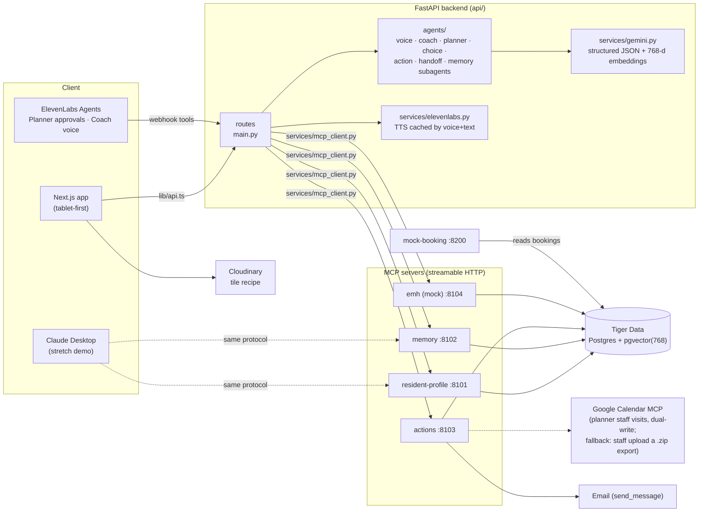

# Architecture

One shared data layer behind four MCP servers. Agents never touch the database — that's the whole pitch: swap the mock EMH server (or the mock booking site) for the real thing and **no agent code changes**.

## Rules the arrows encode

1. **Agents reach data only through the MCP servers** (`api/services/mcp_client.py` is the one path).
2. **ElevenLabs agents use webhook tools that call our backend** — one place for auth and logging.
3. **Confirmed memories ARE the profile**: the profile server reads the memory store; `profile_items` is a view over `memories WHERE status = 'confirmed'`.
4. **The approval gate lives in the actions server** — executing tools refuse any plan the resident hasn't approved, regardless of what the UI does.
5. **Every fact carries source + date** (`resident | staff | emh | document | inferred`) from the moment it enters the store.
6. **Gaze/gesture video never leaves the device** (added Nov 8): WebGazer + MediaPipe run in the browser on one shared camera stream, with consent, off by default. Only batched outcome events reach `POST /input-events` → memory server `log_input_event` → the `input_events` hypertable; `get_input_profile` reads the daily continuous aggregate for adaptive settings and the "How I Communicate" Coach card. Gaze/gesture selections go through the same confirmation as taps. Spec: [GAZE_GESTURE_PLAN.md](GAZE_GESTURE_PLAN.md).

## Swap story (the pitch slide)

| Mock today | Real later | What changes |
|---|---|---|
| emh server (seeded notes) | Real EMH connection | emh server internals only |
| mock-booking page | Real booking providers | actions server internals only |
| Seed-JSON store fallback | Tiger Data (`DATABASE_URL`) | nothing — `store.py` switches automatically |
| Logged-as-sent email | Real SMTP (`EMAIL_SENDER_*`) | nothing — same tool |

## Data flow for the demo beats

- **Speak**: tiles → `/suggest` (Voice agent + `recall`) → approve → `/speak` (cached TTS) → `/sentences` logged → Observer learns from it.
- **Choice + Action**: `/actions/plan` (proposes only) → approval card → `/actions/{id}/approve` → book + calendar + email + staff task, each logged to `action_results` → booking visible on :8200 → ride task appears in Handoff.
- **Memory**: pattern sits `pending` ("Pattern noticed") → resident confirms → `confirmed`, `source=resident` ("In Marcus's words") → Coach and Handoff pick it up immediately.
- **Handoff**: everything since `staff.last_shift_end`, through MCP reads only, every bullet dated.
